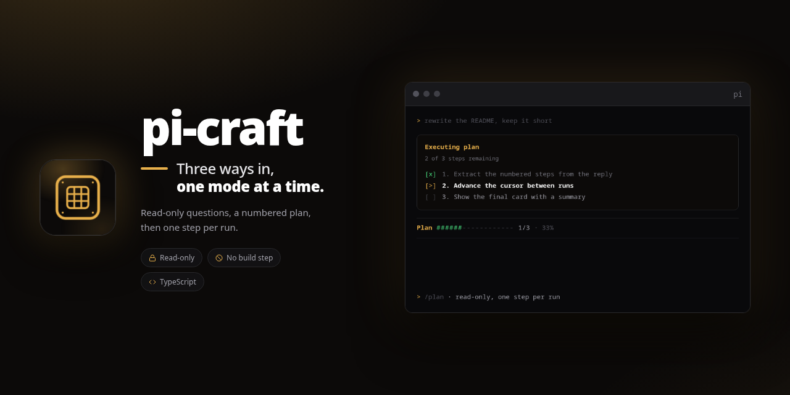

# pi-craft

<p align="center">
  
</p>

> Three ways in, one mode at a time.

<p align="center">
  
  
  
</p>

`pi-craft` gives [pi](https://github.com/earendil-works/pi) three modes — **ask**,
**plan** and **execute** — and only one of them is ever active. It replaces the
separate `pi-ask` and `pi-plan` packages: a single mode runtime owns the tool set,
the read-only guard, the instructions and the persistence, so two modes can never
fight over the active tools. It also ships the commit and pull-request workflows
below, so installing it is all it takes.

## Install

```bash
pi install git:github.com/salvadorsru/pi-craft
```

From a local checkout: `pi install ./pi-craft`. There is no build step and no
dependency: pi loads the TypeScript extension directly.

Remove `pi-ask` and `pi-plan` before installing; the last mode you were in is
migrated from their session entries.

## Usage

| Input | What it does |
|---|---|
| `/ask` | Toggle ask mode |
| `/ask <question>` | Turn ask mode on and ask in one step |
| `/ask on` · `/ask off` · `/ask status` | Control ask mode explicitly |
| `Ctrl+Alt+A` · `--ask` | Shortcut and startup flag |
| `/plan` | Toggle plan mode |
| `/plan on` · `/plan off` · `/plan status` | Control plan mode explicitly |
| `/plan:status` | Show the current plan and its progress |
| `/plan:skip` · `/plan:stop` · `/plan:retry` | Skip the current step, stop the run, retry the open step |
| `Ctrl+Alt+P` · `--plan` | Shortcut and startup flag |

## Skills and prompts

Installing the package installs these too: they are skills and a prompt template
of their own, not part of the mode runtime.

| Command | What it does |
|---|---|
| `/skill:new-commit` | Split the pending changes into semantic commits, one story each |
| `/skill:new-pr` | Draft or open the pull request from the real branch diff |
| `/pack` | Stage everything, then pack it with `new-commit` |

## Modes

### Ask

Read the code, answer, cite `file:line`, and propose a change instead of applying
it. The footer shows `ask` while the mode is on.

### Plan

Explore, then write a numbered list under a `Plan:` header. pi turns it into a
checklist and asks what to do: **Execute the plan**, **Stay in plan mode** or
**Refine the plan**.

When the plan needs a decision, the agent calls `ask_question` instead of ending
its turn with a question in prose: a selector with short options and a free-text
answer. The same tool is available while executing, so a step can resolve a
detail without leaving the plan.

```
Plan  ######------------  1/3 · 33%
[x] 1. Extract the numbered steps from the reply
[>] 2. Advance the cursor between runs
[ ] 3. Show the final card with a summary
```

### Execute

One step per agent run: the checklist advances between runs, so progress shows
up during the work rather than at the end. A step that needs no tool call
declares `[DONE:n]`. When the last step ends, the card repeats the whole list
with the duration and, expanded, the files that changed.

A step can get stuck — a command that keeps failing, or a run cut off by
`aborted`/`error`, which leaves the step open. `/plan:skip` marks it done and
starts the next one, `/plan:retry` runs it again, and `/plan:stop` leaves the
execution without losing the list, so `/plan:status` can still show it.

## What the modes block

- **Tools.** `edit`, `write` and `powershell` are removed while ask or plan is
  active; the full set comes back when you leave.
- **Bash.** Every pipe segment must be a read-only command (`cat`, `grep`, `rg`,
  `find`, `ls`, `tree`, `jq`, `git status/log/diff/show`, `cargo tree`, …).
  Redirection, chaining, substitution, `find -delete`, `sort -o`, `git -c`,
  env assignments that repoint `PATH` or `LD_PRELOAD`, interpreters and package
  managers are rejected.
- **Third-party tools.** A tool that declares `destructiveHint` or
  `openWorldHint` without `readOnlyHint` is blocked too.

The guard is a second line of defence: a mutating call is rejected while a
read-only mode is current, even if the tool was re-enabled mid-session.

## Architecture

```
extensions/craft/index.ts   wires the modes and the legacy entries
src/modes/                  mode state, tool ownership, guard, bash allowlist
src/ask/                    ask mode: commands, badge, instructions
src/plan/                   plan mode: parser, progress, cards, questions
skills/                     new-commit and new-pr, one directory each
prompts/                    pack, which stages everything and calls new-commit
```

- One `ModeRegistry` per session; only it calls `setActiveTools()`, and leaving a
  mode restores the set captured before any mode was applied.
- The mode lives in a `pi-craft` session entry and is restored from the active
  branch on resume; entries from `pi-ask`, `pi-plan` and the short-lived
  `pi-modes` runtime are migrated.

## Development

```bash
bun test
bun run typecheck
```

The suite covers the mode runtime, the bash allowlist, plan extraction, progress
rendering, the question tool, the full flow against a mocked pi, and that every
skill and prompt named in the `pi` manifest exists on disk. CI runs both commands
on every push and pull request.

## License

MIT
